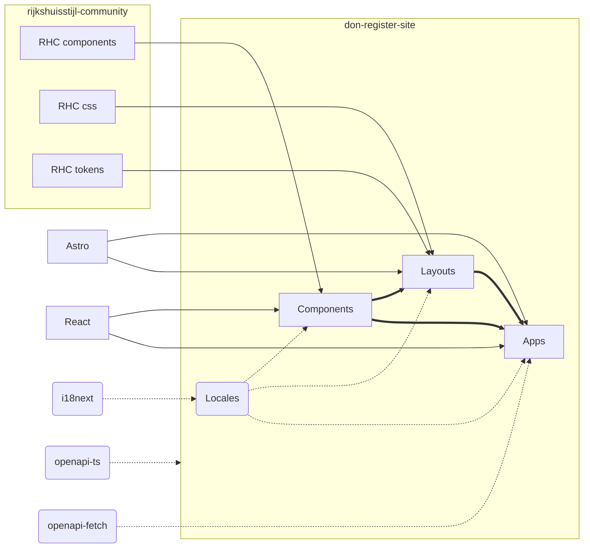

# developer.overheid.nl Register Sites

> De websites en packages van het API-, OSS- en Schema-register van developer.overheid.nl en het [register-site-template].


[](https://biomejs.dev)
[](https://developer-overheid-nl.github.io/don-register-site/)

Deze monorepo bevat de websites van het [API-register](https://apis.developer.overheid.nl), het [Open Source Register](https://oss.developer.overheid.nl) en het [Schema-register](https://schemas.developer.overheid.nl).
De codebase bestaat uit een aantal packages die de gezamelijke codebase (components, layouts, etc) vormen en een `apps`-package waarin de verschillende websites staan. Deze packages worden ook gebruikt in het [register-site-template].

## Packages

### Components

De package `components` bevat de generieke React componenten voor de sites. Deze zijn gebaseerd op de [Rijkshuisstijl Community Componenten](https://github.com/nl-design-system/rijkshuisstijl-community). Welke componenten er precies in zitten kan je vinden in onze [Storybook](https://developer-overheid-nl.github.io/don-register-site/).  
Deze package wordt gepubliceerd op [NPM]: <https://www.npmjs.com/package/@developer-overheid-nl/don-register-components>

### Layouts

De package `layouts` bevat de (generieke) Astro layouts voor de sites. Op dit moment zitten ze in de map `don` zodat er evt andere organisaties bij kunnen komen. Dit kan veranderen.  
Deze package bevat ook een aantal helper-scripts.  
Deze package wordt gepubliceerd op [NPM]: <https://www.npmjs.com/package/@developer-overheid-nl/don-register-layouts>

### Locales

De packages `locales` bevat het localization-bestand voor de (kleine) teksten op de site. Dit is op basis van [i18next](https://www.i18next.com/).  
Op dit moment is er maar 1 locale beschikbaar, namelijk Nederlands (`nl/translation.json`), mogelijk dat er in de toekomst meer talen beschikbaar komen. De `apps` en andere packages kunnen dan aangepast worden met taaldetectielogica.  
Deze package wordt gepubliceerd op [NPM]: <https://www.npmjs.com/package/@developer-overheid-nl/don-register-locales>

## Apps

### API-register

> Dit is het API-register van de Nederlandse overheid: alle API’s op één plek.  
> [apis.developer.overheid.nl](https://apis.developer.overheid.nl)

De [Astro] site van het API-register.

Zie ook de [README](https://github.com/developer-overheid-nl/don-register-site/blob/main/apps/api-register/README.md) van deze package.

### Open Source Register

> Dit is het Open Source Register van de Nederlandse overheid: alle open source repositories op één plek.  
> [oss.developer.overheid.nl](https://oss.developer.overheid.nl)

De [Astro] site van het Open Source Register.

### Schema-register

> Dit is het Schema-register van de Nederlandse overheid (bèta): JSON Schemas die beschikbaar zijn voor (her)gebruik binnen de overheid.  
> [schemas.developer.overheid.nl](https://schemas.developer.overheid.nl)

De [Astro] site van het Schema-register.

### Je eigen register

In de repository [register-site-template] staat een template voor het bouwen van sites op basis van de packages in deze monorepo.

## Overige mappen en bestanden

### Proprietary-\*

De map `proprietary-example` bevat voorbeeldbestanden voor bestanden waar meestal een copyright op zit, zoals logo's, fonts en iconen. Dit zijn rechtenvrije bestanden, die in het register-template gebruikt kunnen worden als voorbeeld. Deze package wordt ook gepubliceerd op [NPM]: <https://www.npmjs.com/package/@developer-overheid-nl/proprietary-example>  
De map `proprietary-don` bevat bestanden voor onze eigen register-sites die niet zomaar gebruikt mogen worden, zoals logo's, fonts en iconen. Dit zal ook niet gepubliceerd worden op NPM.

Om onze eigen `proprietary-don` package te registreren wordt in de `package.json` een alias toegevoegd, bijvoorbeeld:

```json
{
  "dependencies": {
    "@developer-overheid-nl/proprietary": "workspace:@developer-overheid-nl/proprietary-don@*"
  }
}
```

Op dezelfde manier wordt in de [register-site-template] een alias toegevoegd, maar dan naar het `proprietary-example` package:

```json
{
  "dependencies": {
    "@developer-overheid-nl/proprietary": "workspace:@developer-overheid-nl/proprietary-example@*"
  }
}
```

En kan er naar een eigen implementatie verwezen worden in de eigen register-site.  
In de codebase wordt er dus altijd verwezen naar `@developer-overheid-nl/proprietary`.

### Types

Typescript declarations.

### redocly.yaml

Het bestand `redocly.yaml` bevat de OpenAPI-specificaties (productie en test) van de API's achter de apps. Met `pnpm generate:oas:types` worden daar TypeScript-types van gemaakt voor [openapi-fetch](https://openapi-ts.dev/openapi-fetch/).
Hoe je wisselt tussen de productie- en test-API staat in [MAINTENANCE.md](MAINTENANCE.md#3-generated-files-never-edit-by-hand).

## Structuur



## (Dev)Dependencies

Node.js versie 22.x of 24.x is vereist.
Installeer de gepinde node versie via [fnm](https://github.com/Schniz/fnm) of andere node version manager die .node-version files ondersteunt.

- Astro: Site build, routing, SSR / SSG
- React: Components
- i18Next: Localisation
- Typescript
- Vite
- OpenAPI TypeScript: Type declarations & fetch
- RijkshuisstijlCommunity: React Components
- Biome: formatting, linting and assist
- Changesets, manage versioning and changelogs

## Onderhoud en ontwikkeling

- [AGENTS.md](AGENTS.md): alle commando's, de architectuur en de conventies (Engels).
- [MAINTENANCE.md](MAINTENANCE.md): waar nieuwe code hoort, dependencies updaten, versioneren met [Changesets](https://github.com/changesets/changesets), releasen en deployen (Engels).
- [CHANGELOG.md](CHANGELOG.md): overzicht van de changelogs per package.

Formatting en linting gaan via [Biome]. Installeer de VSCode-extensie: [](vscode:extension/biomejs.biome)

## Contact

[💬 Slack](https://codefornl.slack.com/archives/CFV4B3XE2) •&nbsp;
[🐘 Mastodon](https://social.overheid.nl/@developer) •&nbsp;
[👔 LinkedIn](https://www.linkedin.com/company/92926607) •&nbsp;
[📨 Schiet een issue in](https://github.com/developer-overheid-nl/don-register-site/issues) •&nbsp;
[🔀 Github Discussions](https://github.com/orgs/developer-overheid-nl/discussions) •&nbsp;
[📜 Bijdragen](https://developer.overheid.nl/contributing)

---

## Aan de slag

Alle commando's draai je vanuit de root van de repository:

```sh
pnpm install   # dependencies installeren
pnpm start     # interactief menu met alle scripts
pnpm dev       # alle drie de sites lokaal starten (vanaf localhost:4321)
```

Zie [AGENTS.md](AGENTS.md#commands) voor alle commando's en [MAINTENANCE.md](MAINTENANCE.md#6-deploying) voor deployen.

[Astro]: https://astro.build/
[Biome]: https://biomejs.dev/
[NPM]: https://www.npmjs.com/
[register-site-template]: https://github.com/developer-overheid-nl/register-site-template
